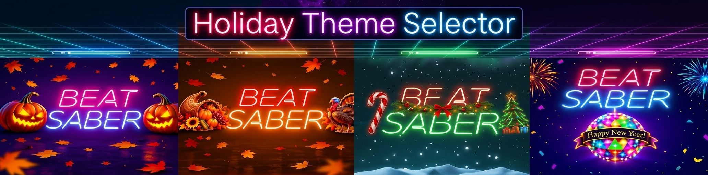

# 📅 Holiday Theme Switcher

▶️ **Watch on YouTube:** https://www.youtube.com/watch?v=z8a1MtGv3DM

Switch between seasonal Beat Saber menu environments instantly, or let the calendar select a theme automatically.

Based on the fantastic Christmas Mod by Vcmikuu and CatsaCode.

Note: Development assisted with use of A.I. Please support talented artists and coders whenever possible.

**Compatible with:** Beat Saber 1.40.8 & 1.45.3 (Quest)

## Themes

- **Default 🎮** — Beat Saber's standard menu appearance and soundtrack.
- **Halloween 🎃** — Happy Halloween! Transform your Beat Saber menu into a spooky graveyard with falling autumn leaves.
- **Thanksgiving 🦃** — Transform your Beat Saber menu with golden harvest lighting, seasonal decorations, and gently falling leaves!
- **Christmas Eve ❄️** — Celebrate Christmas Eve on a peaceful, snowy alpine winter night.
- **New Years 🥂** — Transform your Beat Saber menu into a dazzling midnight celebration with colorful fireworks, falling confetti, and custom songs from your very own playlist!
- **Dynamic 📅** — Chooses the appropriate theme using the headset's local time and date.

### Dynamic calendar

| Dates | Theme |
| --- | --- |
| February 1–September 30 | Default |
| October 1–31 | Halloween |
| November 1–30 | Thanksgiving |
| December 1–30 | Christmas Eve  |
| December 31–January 31 | New Years |

Manual selections stay selected until changed. A saved original Christmas selection opens Christmas Eve. Dynamic mode rechecks the calendar while outside gameplay.

## Installation and use

1. Download the **v1.0.0 QMOD** from the matching GitHub release after publication, or the successful release-candidate GitHub Actions artifact for testing.
2. Install it using your normal Quest Beat Saber mod installer for **1.40.8_7379** or **1.45.3_30054**
3. **Disable standalone Halloween, Thanksgiving, Christmas, Christmas Eve, and New Year's theme mods** before using the switcher. They can compete for the same menu effects and audio.
4. Open **Holiday Theme Switcher** from the Beat Saber main menu, then choose a theme or **Dynamic**.

The selection is stored at `/sdcard/ModData/com.beatgames.beatsaber/Mods/SeasonalThemes/theme.txt`. A fresh installation with no saved selection currently starts in Halloween mode; choose Default or Dynamic to change it.

New Year's music uses **existing user-installed custom songs**; no custom-song audio is included. The confetti and fireworks can remain inactive on the song-selection screen after gameplay and resume on returning to the main menu. This is an accepted behavior for this release.

## Source, licensing and credits

The combined source code is released under **GNU GPLv3 (GPL-3.0-only)**. Read [LICENSE](LICENSE) and [THIRD_PARTY_NOTICES.md](THIRD_PARTY_NOTICES.md) for third-party code, assets, audio provenance, attribution, and outstanding verification items.

The project incorporates work derived from [Christmas Theme](https://github.com/vcmikuu/ChristmasTheme) by **laynia (vcmikuu)** and **CatsaCode**, with [GPLv3 reuse authorization and credit requirements](https://github.com/vcmikuu/ChristmasTheme/issues/1#issuecomment-6711835142), alongside [Halloween Theme](https://github.com/Abomination2169/Halloween-Theme), [Thanksgiving Theme](https://github.com/Abomination2169/Thanksgiving-Theme), and [New Year's Theme](https://github.com/Abomination2169/New-Years-Theme). Seasonal adaptations and switcher integration by **Abomination2169**, developed with AI assistance in 2026. This is not an official upstream Christmas Theme release.

**For source corresponding to a release QMOD, use its exact release tag/commit and workflow**, not an unrelated branch. The workflow retrieves assets from pinned upstream commits at build time.

This mod is for Beat Saber on Quest and is not affiliated with Beat Games or Meta.
